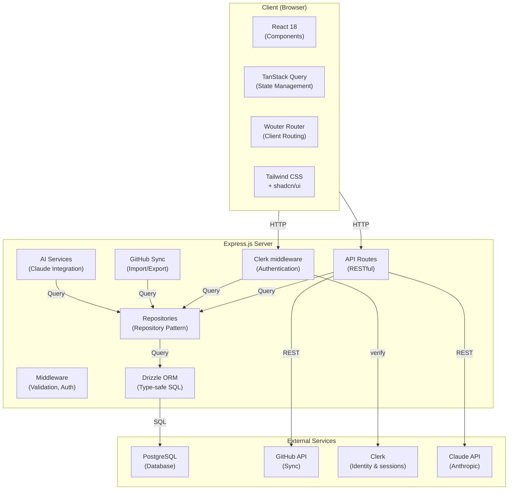
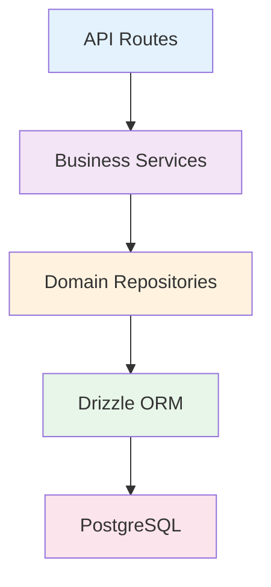
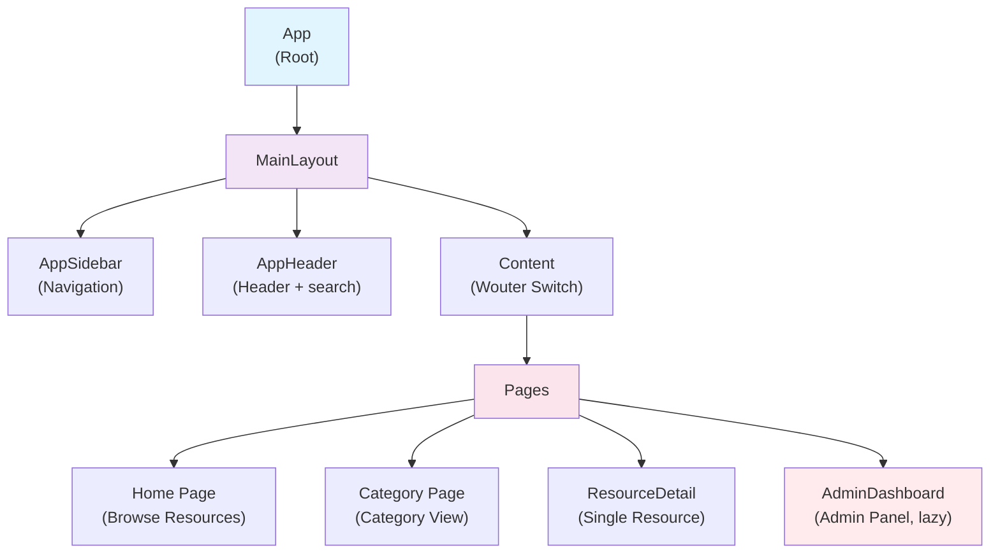
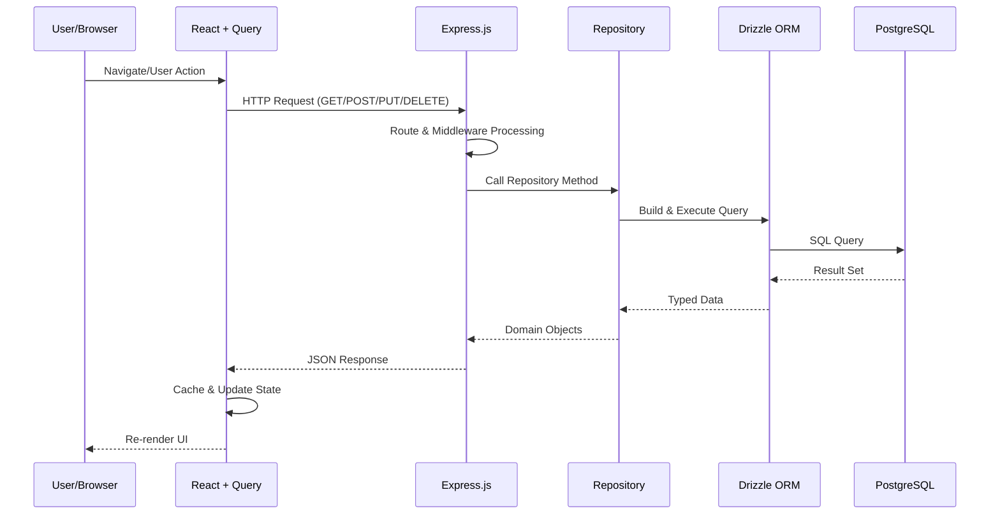
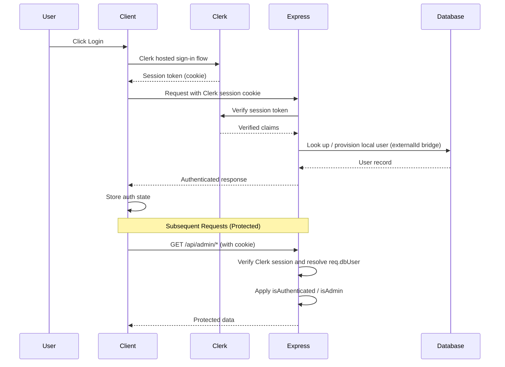
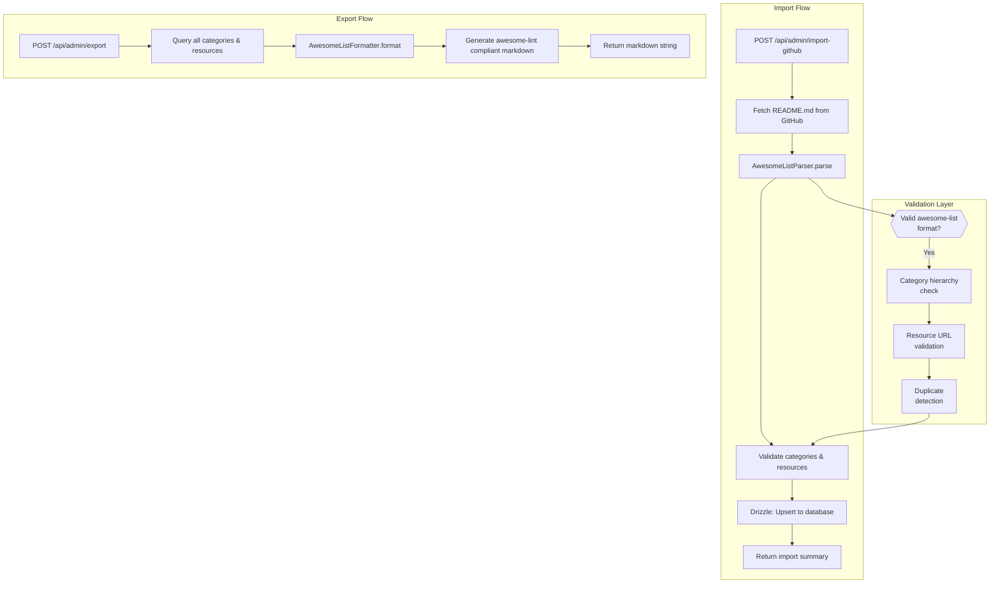
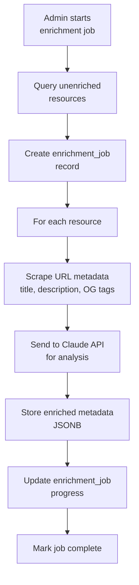

# System Architecture

Technical architecture documentation for the Awesome Video Resource Viewer application.

## Overview

The Awesome Video Resource Viewer is a full-stack application built with modern web technologies. It serves as a curated platform for discovering video development resources, featuring AI-powered recommendations, GitHub integration, and admin curation tools.

### System Architecture Diagram



## Technology Stack

### Frontend
| Technology | Purpose |
|------------|---------|
| React 18+ | UI framework |
| TypeScript | Type safety |
| Vite | Build tool & dev server |
| TanStack Query v5 | Server state management |
| Wouter | Client-side routing |
| Tailwind CSS | Utility-first styling |
| shadcn/ui | Component library |
| Lucide React | Icons |
| Fuse.js | Fuzzy search |

### Backend
| Technology | Purpose |
|------------|---------|
| Express.js | HTTP server |
| TypeScript | Type safety |
| Drizzle ORM | Database ORM |
| Clerk Express SDK | Authentication and session verification |
| Zod | Schema validation |
| Remark | Markdown parsing |

### Database
| Technology | Purpose |
|------------|---------|
| PostgreSQL (Neon) | Primary database |
| Drizzle Kit | Migrations |

### External Services
| Service | Purpose |
|---------|---------|
| Anthropic Claude | AI analysis, enrichment & agent research |
| OpenAI | Embeddings & optional AI features |
| GitHub API | Repository sync |
| Clerk | Credentials, sign-in/sign-up UI, and sessions |
| Google Analytics | Usage analytics |

### Rendering & theming

- **No Next.js, no React SSR.** The app is a Vite-built React SPA served by Express.
  For crawlers, `server/og-middleware.ts` (with `server/ssr.ts`) injects a full meta/OG
  tag set at request time ("SSR-lite"); after hydration react-helmet manages the live head.
- **Runtime design-system switcher.** The UI ships multiple design systems selectable at
  runtime (Editorial is the default), plus a light/dark/auto theme, managed by
  `ThemeProvider` (`client/src/components/ui/theme-provider.tsx`) and the `use-theme` hook,
  persisted to `localStorage`.

## Directory Structure

```
├── client/                 # Frontend application
│   ├── src/
│   │   ├── components/     # Reusable UI components
│   │   │   ├── ui/         # shadcn/ui primitives
│   │   │   ├── layout/     # Layout components
│   │   │   └── ...
│   │   ├── pages/          # Route pages
│   │   ├── hooks/          # Custom React hooks
│   │   ├── lib/            # Utilities & helpers
│   │   └── App.tsx         # Root component & routing
│   └── index.html
├── server/                 # Backend application
│   ├── repositories/       # Data access layer (Repository Pattern)
│   │   ├── ResourceRepository.ts
│   │   ├── CategoryRepository.ts
│   │   ├── UserRepository.ts
│   │   ├── TagRepository.ts
│   │   ├── LearningJourneyRepository.ts
│   │   ├── UserFeatureRepository.ts
│   │   ├── AuditRepository.ts
│   │   ├── GithubSyncRepository.ts
│   │   ├── EnrichmentRepository.ts
│   │   ├── AdminRepository.ts
│   │   ├── LegacyRepository.ts
│   │   └── index.ts        # Barrel export
│   ├── ai/                 # AI services (Claude / OpenAI, agents)
│   │   ├── claudeService.ts
│   │   ├── enrichmentService.ts
│   │   ├── researchService.ts
│   │   ├── agentRuntime.ts
│   │   ├── recommendationEngine.ts
│   │   ├── embeddingService.ts
│   │   ├── configCrypto.ts
│   │   └── urlScraper.ts
│   ├── github/             # GitHub integration
│   │   ├── syncService.ts
│   │   ├── formatter.ts
│   │   ├── parser.ts
│   │   └── client.ts
│   ├── validation/         # Validation services
│   │   ├── awesomeLint.ts
│   │   ├── linkChecker.ts
│   │   └── inputs.ts
│   ├── db/                 # Drizzle connection (pg pool)
│   ├── routes.ts           # Route composition root
│   ├── routes/domains/     # Domain-owned API registrars
│   ├── contracts/          # Guards, response contracts, OpenAPI generation
│   ├── storage.ts          # IStorage facade over repositories
│   ├── migrate.ts          # Boot-time migration runner
│   ├── clerkAuth.ts        # Clerk-to-local-user bridge and auth gates
│   ├── health.ts           # Database-dependent readiness probe
│   ├── og-middleware.ts    # Crawler SSR-lite (meta injection)
│   └── index.ts            # Server entry point
├── shared/                 # Shared code
│   ├── schema.ts           # Database schema & types
│   └── validation.ts       # Shared content validation rules
├── migrations/             # Journaled SQL migrations
├── scripts/                # Utility scripts
└── docs/                   # Documentation
```

## Backend Architecture Patterns

### Repository Pattern

The backend implements the **Repository Pattern** to separate data access logic from business logic, providing a clean abstraction layer over database operations.

#### Structure

The repository layer is organized by domain (classes, PascalCase files):

```
server/
├── repositories/
│   ├── ResourceRepository.ts         # Resource CRUD & approval workflow
│   ├── CategoryRepository.ts         # 3-level category hierarchy
│   ├── UserRepository.ts             # User accounts, roles, auth
│   ├── TagRepository.ts              # Tags & resource tagging
│   ├── LearningJourneyRepository.ts  # Journeys & progress
│   ├── UserFeatureRepository.ts      # Favorites, bookmarks, preferences
│   ├── AuditRepository.ts            # Audit log & edit suggestions
│   ├── GithubSyncRepository.ts       # GitHub sync queue & history
│   ├── EnrichmentRepository.ts       # AI enrichment jobs & queue
│   ├── AdminRepository.ts            # Admin statistics
│   ├── LegacyRepository.ts           # Hierarchical corpus builders
│   └── index.ts                      # Barrel export
```

#### Benefits

1. **Separation of Concerns**: Database queries are isolated from business logic
2. **Validation**: Repository behavior can be exercised independently of route composition
3. **Maintainability**: Centralized data access patterns
4. **Type Safety**: Drizzle ORM provides full TypeScript type inference
5. **Reusability**: Common queries are defined once and reused across services

#### Usage Example

```typescript
// Option A — instantiate a domain repository directly (preferred for new code)
import { ResourceRepository } from './repositories';

const resourceRepo = new ResourceRepository();
const resources = await resourceRepo.getResources();
const resource = await resourceRepo.getResourceById(id);

// Option B — use the unified storage facade (backward compatible)
import { storage } from './storage';

const resource = await storage.getResourceById(id);
```

#### Architecture Diagram



#### storage.ts and the repository layer

`server/storage.ts` still exists, but it is now a thin **facade** implementing the
`IStorage` interface by delegating each method to the appropriate domain repository. This
preserves the existing `storage.*` call sites while new code can import repositories
directly for better modularity.

| Legacy pattern | Current pattern |
|----------------|-----------------|
| `import { storage } from './storage'` | `import { ResourceRepository } from './repositories'` |
| `storage.getResourceById(id)` (still works) | `new ResourceRepository().getResourceById(id)` |
| One monolithic data-access file | One focused repository per domain + facade |
| Mixed concerns | Single responsibility per repository |

This structure improves organization and testability while keeping backward compatibility
through the facade.

## Component Hierarchy



## Data Flow

### Request/Response Cycle Sequence Diagram



### Authentication Flow (Detailed)



### GitHub Sync Flow (Import & Export)



### AI Enrichment Flow



## Database Schema

> **📖 For detailed database schema documentation, see [DATABASE.md](./DATABASE.md)**

### Core Tables

**users**
- Clerk bridge identity and local application roles/profile fields
- Roles: user, admin, moderator

**resources**
- Core resource entries
- Status: pending, approved, rejected, archived
- Metadata stored as JSONB

**categories / subcategories / sub_subcategories**
- 3-level hierarchy for navigation
- Slugs for URL routing

**resource_edits**
- User-submitted edit suggestions
- Conflict detection via originalResourceUpdatedAt

**resource_audit_log**
- Complete audit trail of all changes

### Support Tables

**learning_journeys / journey_steps / user_journey_progress**
- Learning path functionality

**user_favorites / user_bookmarks / bookmark_collections / bookmark_collection_items /
user_preferences / user_interactions / user_recommendation_feedback**
- User engagement, organization, personalization, and recommendation feedback

**notification_preferences / digest_unsubscribe_tokens / in_app_notifications /
digest_jobs / digest_attempts**
- Reminder settings, in-app notifications, and digest delivery

**github_sync_queue / github_sync_history**
- GitHub sync state management

**enrichment_jobs / enrichment_queue**
- AI batch enrichment tracking (with per-run agent config)

**research_jobs / research_discoveries / agent_events**
- Claude Agent SDK research runs and structured agent event log

**link_health_jobs / link_health_checks**
- Link-health scanning results

**api_keys**
- Programmatic public-API access

**sessions / password_reset_tokens**
- Retained legacy pre-Clerk rows; not active auth/session storage

**tags / resource_tags**
- Tag management (many-to-many)

> The complete 38-table inventory is documented in [DATABASE.md](./DATABASE.md);
> `shared/schema.ts` remains authoritative for columns and indexes.

## Security Measures

### Authentication
- Clerk verifies credentials and sessions
- `clerkUserContext` resolves a local application user on each relevant request
- Email collisions during just-in-time provisioning fail closed
- HTTPS enforced in production

### Authorization
- Role-based access control (RBAC)
- isAuthenticated middleware
- isAdmin middleware for admin routes

### Input Validation
- Zod schemas for all inputs
- Whitelisted editable fields for edit suggestions
- Field size limits enforced
- SQL injection prevented via Drizzle ORM

### API Security
- CORS configured for production
- Rate limiting on external APIs
- Secrets stored in environment variables

## Performance Considerations

### Caching
- TanStack Query client-side caching
- Database query optimization with indexes
- Static asset caching via Vite

#### Public page cache and invalidation

Three layers sit between a visitor and the database. Each has its own rule.

- **HTML documents are never cached.** Every document embeds a per-request CSP
  nonce, so `server/og-middleware.ts` sends `Cache-Control: no-store` on HTML
  for GET and HEAD and removes `ETag` and `Last-Modified`. A cached or
  304-revalidated document would pair an old nonce with a new header and block
  every inline script. Do not weaken this.
- **Catalog reads may be reused for 60 s.** `server/http-cache-policy.ts`
  defines the strings: `CATALOG_CACHE_CONTROL` is
  `public, max-age=60, must-revalidate`, used by the nav, category, tag and
  subcategory reads, the kind counts and the home feed. Catalog variants
  outside the known taxonomy use `UNCACHED_CATALOG_CACHE_CONTROL`
  (`public, max-age=0, must-revalidate`). Hashed `/assets/*` bundles are
  immutable for a year. Add a new public class to that file, not as a literal
  in a route.
- **Server-side reads share one in-process cache.** `getPublicCacheValue()` in
  `server/cache/publicCache.ts` holds catalog bodies, nav, taxonomy and the
  `route-meta` namespace under a caller-supplied TTL, normally 60 s. Concurrent
  misses share one loader, a failed loader is never replaced by stale data,
  and the cache is bounded (4,096 entries, 48 MiB, 64 rebuilds in flight). A
  miss past the 64 waits up to 5 s for a rebuild slot (at most 512 waiters)
  instead of being turned away at once; after 5 s without a slot, or with 512
  already waiting, it still gets a 503. The cache is per process, not shared
  between instances.
- **Page metadata is cached for 6 h.** `resolveRoute()` in
  `server/og-middleware.ts` resolves the title, description and found/not-found
  state for a path through `getPublicCacheValue()` with `ttlMs:
  ROUTE_META_TTL_MS` (6 hours; namespace `route-meta`). Crawlers visit each
  route about once, so a 60 s TTL never hit. Freshness does not depend on the
  TTL: every catalog write calls `invalidatePublicCache()`. The key is the path
  plus `?page=` (and `/sign-in?admin`). `/search`, filtered category pages and
  `/collection/*` bypass it, so an unpublished shared collection is never
  served from it.

**When a change becomes visible.** Every resource, category and tag write calls
`invalidatePublicCache(reason)` with `resource-mutation`, `category-mutation`,
`tag-mutation`, `seed-mutation` or `manual`. The call runs after the
enclosing transaction commits (`afterCommit`), so a rolled-back write clears
nothing and a reader cannot re-cache the pre-commit rows. It bumps a
generation and clears every public entry, and a loader that started before the
bump is discarded and retried. Creating, editing, approving, rejecting,
withdrawing and deleting a resource, and approving a resource edit, all
invalidate (`server/repositories/ResourceRepository.ts`,
`resourcePublication.ts`, `AuditRepository.ts`).

- On the instance that handled the write, the next server render and API read
  see the change at once.
- A browser that already holds a catalog API response keeps it for up to 60 s
  without asking (`max-age=60`); after that it revalidates. The page document
  itself is always fetched fresh.
- Other instances do not hear about the write directly. Each serving instance
  reads a fingerprint of the catalog tables (`server/cache/catalogStamp.ts`)
  in the background at most once per 30 s, and clears its cache when the
  fingerprint changes (reason `catalog-stamp`). The fingerprint hashes each
  resource's id, `updated_at`, status, category path and `metadata.tags`, and
  the exact (resource, tag) pairs, so a same-millisecond edit, a tag
  canonicalization and a tag swap all change it. There is no timer, so an idle
  instance never queries. The check starts from a cache read and is not awaited:
  the request that finds it due is still served the old entry, and the clear
  lands when the query resolves. A new or edited resource can therefore take
  one 30 s check interval plus one request to reach an instance that did not
  handle the write, plus the 60 s a browser may reuse an API response. A check
  that fails clears nothing and is retried by the next cache read after the
  interval, so the bound holds only while the database answers. Do not expect
  an audit to see a change sooner on a second request.

**Facets.** `listResources()` counts facet groups only when asked: the
`facets` option takes the kinds to count (`categories`, `subcategories`,
`subSubcategories`, `tags`, `providers`, `formats`, `skillLevels`, from
`RESOURCE_FACET_KINDS` in `shared/resourceFacets-core.ts`). Omitted means none.
Each kind adds one `UNION ALL` branch to a single extra query, so ask only for
what the page renders. For example, the sitemap build in
`server/routes/non-api.ts` passes `facets: ["tags"]`, and
`GET /api/resources?facets=categories` counts only categories for the tag
landing page (`true` counts every kind, `false` none).

### Database
- Connection pooling via Neon
- Indexes on frequently queried columns
- JSONB for flexible metadata storage

### Frontend
- Code splitting via dynamic imports
- Lazy loading of heavy components
- Optimized bundle size

## Environment Variables

See [ENVIRONMENT.md](./ENVIRONMENT.md) for the canonical categorized list. A representative
subset:

```bash
# Database
DATABASE_URL=postgresql://...

# Authentication (Clerk)
VITE_CLERK_PUBLISHABLE_KEY=...
CLERK_PUBLISHABLE_KEY=...
CLERK_SECRET_KEY=...
VITE_CLERK_PROXY_URL=/api/__clerk    # optional proxy path

# AI (managed Anthropic key preferred; ANTHROPIC_API_KEY as fallback)
AI_INTEGRATIONS_ANTHROPIC_API_KEY=...
CONFIG_ENCRYPTION_KEY=...            # encrypts per-run agent auth tokens

# GitHub sync
GITHUB_TOKEN=...
GITHUB_REPO_URL=...

# Frontend / optional
VITE_GA_MEASUREMENT_ID=...
NODE_ENV=development|production
```

## Deployment

The application is designed for Replit deployment:

1. **Development**: `npm run dev` starts Vite + Express
2. **Production**: `npm run build` → `npm run start`
3. **Database**: Replit PostgreSQL (Neon-backed)
4. **Secrets**: Managed via Replit Secrets tab
5. **Deploy**: Replit's built-in deployment system

## Monitoring & Logging

- Server logs go through one helper, `server/lib/logger.ts`
  (`createLogger(area)`): every line is `time LEVEL [area] message key=value`,
  with the request id and method + path when it runs inside a request, and
  one status line per API request (non-API pages only when they fail). Secret
  values, token shapes, emails and IPs are scrubbed before printing. Background
  jobs (GitHub import/export, enrichment, research, link scans, backups,
  digests, heavy work) log a start, an outcome and the reason for any failure.
  Don't call `console.*` in server runtime code; use the area logger.
- Audit log for resource changes (admin actions)
- Frontend analytics through the shared `track()` sender (see `ANALYTICS.md`)
- Process liveness: `GET /api/health` or `GET /api/health/live`
- Database/migration readiness: `GET /api/health/ready`
